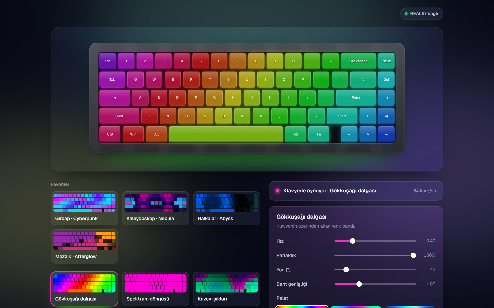
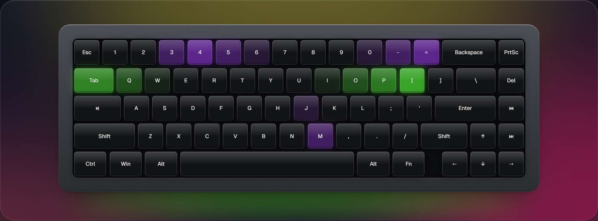
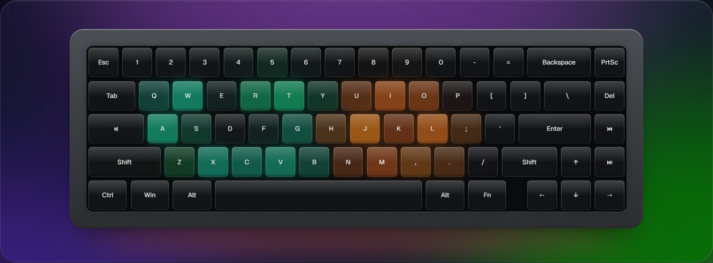
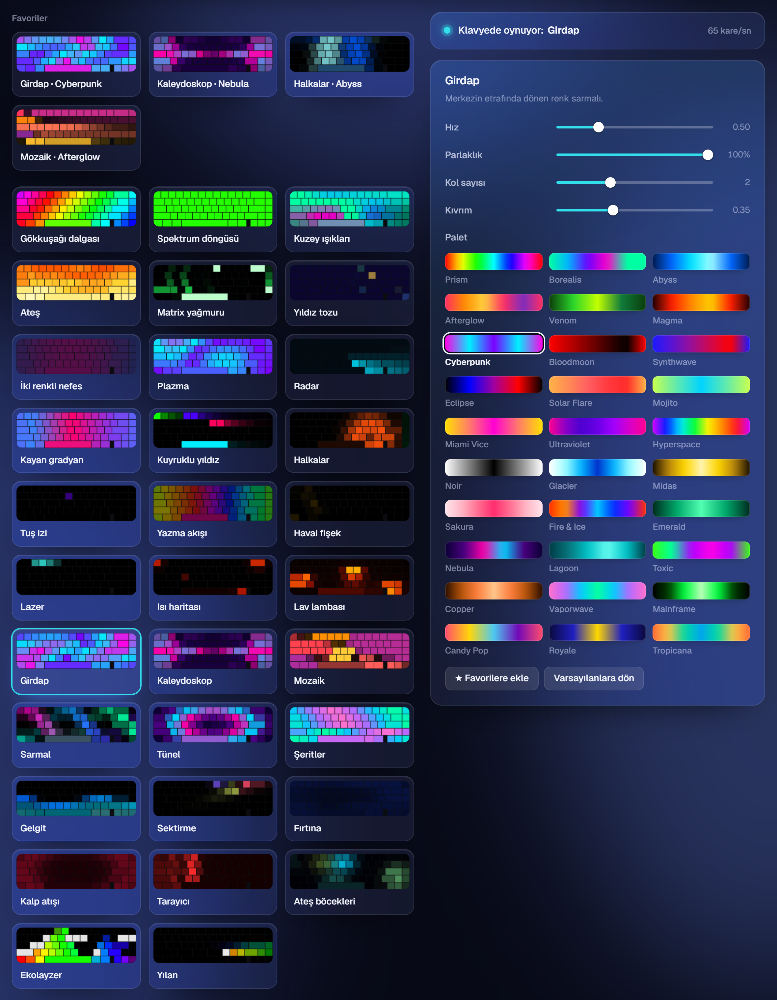
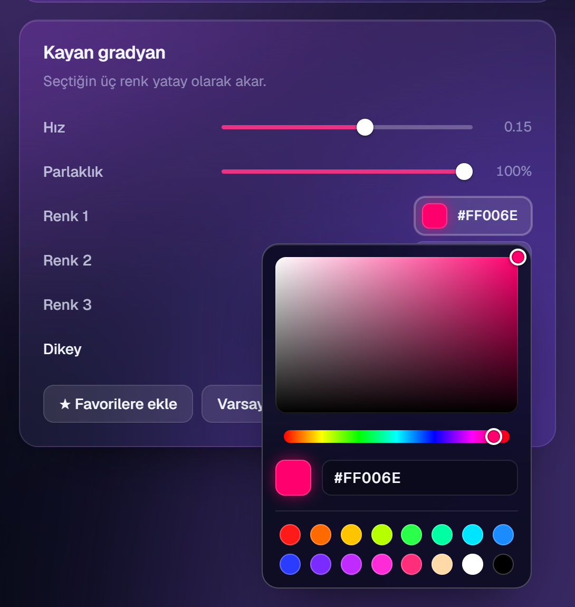
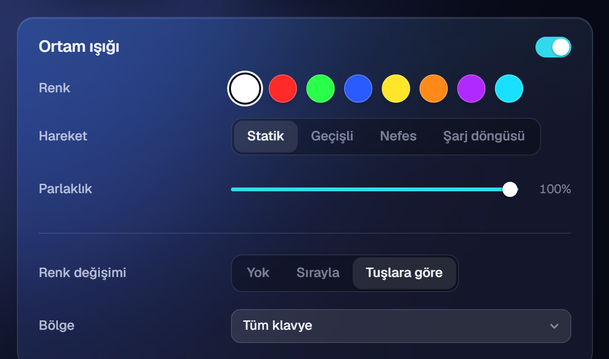

# Real67 Studio

An unofficial lighting controller for the MelGeek **Real67** keyboard. The keyboard's built-in RGB modes are few and limited, so this project adds **39 live effects**, **30 colour palettes**, key-reactive lighting, favourites, hotkeys and ambient (mood) light control.

A small background service plays the effects. You can close the browser and the lights keep flowing; after a reboot they pick up where they left off.

> **Safe by design:** only lighting commands are ever sent to the keyboard. Key mappings, rapid trigger and every other keyboard setting are left untouched.



> The interface is in Turkish. Effect and setting names are translated in the tables below.

## Contents

- [Why this exists](#why-this-exists)
- [Features](#features)
- [Screenshots](#screenshots)
- [Effects](#effects)
- [Installation](#installation)
- [Usage](#usage)
- [Using it alongside MelGeek Hive](#using-it-alongside-melgeek-hive)
- [How it works](#how-it-works)
- [Files](#files)
- [Limitations](#limitations)

## Why this exists

The Real67's official tool, [MelGeek Hive](https://hive.melgeek.com), offers only a handful of preset lighting modes and no way to make your own animation. This project was written from scratch to fill that gap:

1. **Reverse-engineered the protocol.** MelGeek does not publish the keyboard's USB protocol. Capturing and studying the packets Hive sends revealed the lighting commands: writing key colours, setting the lighting mode and brightness, and changing the ambient light.
2. **Found the firmware's limits.** The keyboard cannot store a custom animation, and its built-in "Wave" and "Gradient" modes ignore the colours you write and play their own rainbow. The only way to get a custom effect is to stream the colours from the computer.
3. **Wrote a background service.** A small Node.js service computes the effect and writes all 67 key colours to the keyboard about 60 times per second. It opens no window and can start automatically with Windows.
4. **Wrote a web interface.** The same service serves a single-screen interface at `http://localhost:8667`. Click an effect and it plays on the keyboard. Because the interface talks to the service, it also works in browsers without WebHID (Firefox, Zen).
5. **Protected the keyboard's settings.** The driver code refuses to send any non-lighting command group. Rapid trigger, actuation point and key-mapping blocks were read before and after lighting operations and stayed byte-for-byte identical. A separate test (`service/klavye-testi.mjs`) measured no effect on 8000 Hz polling or key latency while lights are streaming.

## Features

- **39 live effects**, each with its own speed, brightness and style settings
- **Key-reactive effects** (Ripples, Key trail, Typing flow, Fireworks, Laser, Heat map, Constellation, Lightning) that react to whatever you type, in any program; the keyboard stays dark until you press a key
- **30 colour palettes**, selectable in every effect that uses one
- **Favourites:** save an effect with its exact settings and replay it in one click
- **Hotkeys:** switch effects and change brightness without opening the interface
- **Ambient light:** colour, mode, speed and brightness, plus automatic colour that follows the playing effect
- **Runs without a browser:** effects keep playing in the background
- **Autostart:** the last effect resumes when Windows starts
- **Plays nicely with Hive:** the service pauses itself when Hive connects to the keyboard
- The interface takes on the colours of the selected effect

## Screenshots

**Key-reactive effects:** nothing is lit until you type. Left: Laser, beams shoot along the row and column of each pressed key. Right: Fireworks, sparks scatter from each pressed key.

<p>
  
  
</p>

**Effects, favourites and palettes.** Every effect card shows a live preview. Favourites sit above the list; the settings panel holds the sliders and all 30 palettes.



<table>
  <tr>
    <td width="50%"></td>
    <td width="50%"></td>
  </tr>
  <tr>
    <td><b>Built-in colour picker</b> for effects with custom colours: saturation/brightness area, hue strip, hex input and presets.</td>
    <td><b>Ambient light:</b> 8 firmware colours, motion mode, brightness, and automatic colour that cycles or follows the keys.</td>
  </tr>
</table>

## Effects

| Effect (name in UI) | What it does |
|---|---|
| Rainbow wave (*Gökkuşağı dalgası*) | A colour band flowing across the keyboard |
| Spectrum cycle (*Spektrum döngüsü*) | All keys change colour together |
| Northern lights (*Kuzey ışıkları*) | Slowly rippling curtains of colour |
| Fire (*Ateş*) | Flames rising from the bottom row |
| Matrix rain (*Matrix yağmuru*) | Digital drops falling down the columns |
| Stardust (*Yıldız tozu*) | Keys twinkling over a calm background |
| Two-colour breathe (*İki renkli nefes*) | Smooth blend between two colours |
| Plasma (*Plazma*) | The classic demoscene plasma field |
| Radar (*Radar*) | A sweeping beam rotating around the centre |
| Sliding gradient (*Kayan gradyan*) | Three colours of your choice flowing sideways |
| Comet (*Kuyruklu yıldız*) | Stars gliding along the rows, leaving trails |
| **Ripples** (*Halkalar*) | Rings spread out from each key you press |
| **Key trail** (*Tuş izi*) | The key you press lights up and slowly fades |
| **Typing flow** (*Yazma akışı*) | A colour flow that speeds up and brightens as you type |
| **Fireworks** (*Havai fişek*) | Sparks scatter from each key you press |
| **Laser** (*Lazer*) | Beams shoot along the row (and column) of each key you press |
| **Heat map** (*Isı haritası*) | Keys warm up as you press them; busy areas change colour |
| **Constellation** (*Takımyıldız*) | A line of light joins each key you press to the previous one |
| **Lightning** (*Yıldırım*) | Electric arcs jump from key to key, away from each key you press |
| Lava lamp (*Lav lambası*) | Blobs of colour merging and splitting |
| Vortex (*Girdap*) | A colour spiral rotating around the centre |
| Kaleidoscope (*Kaleydoskop*) | An ever-changing pattern mirrored from the centre |
| Mosaic (*Mozaik*) | Drifting panes of coloured glass with dark seams |
| Helix (*Sarmal*) | Two strands of light winding around each other |
| Tunnel (*Tünel*) | Colour rings flowing out from (or into) the centre |
| Lanes (*Şeritler*) | Each row flows in its own direction and speed |
| Tide (*Gelgit*) | Water filling the lower keyboard with a rippling surface |
| Bounce (*Sektirme*) | Balls of light bouncing off the edges, leaving trails |
| Warp speed (*Işık hızı*) | Stars streaming out from the centre, speeding up as they go |
| Orbit (*Yörünge*) | Planets circling a sun in the middle, leaving trails |
| Circuit (*Devre*) | Signals running along the rows and turning corners like circuit traces |
| Stack (*Yığın*) | Coloured blocks slide in and fill the rows; when full, they are swept away |
| Chevron (*Şevron*) | Arrow-shaped colour bands flowing across the keyboard |
| Storm (*Fırtına*) | Dark clouds and flashes of lightning |
| Heartbeat (*Kalp atışı*) | A double-beat pulse spreading from the centre |
| Scanner (*Tarayıcı*) | A bar of light sweeping back and forth |
| Fireflies (*Ateş böcekleri*) | Soft points of light drifting in the dark |
| Equalizer (*Ekolayzer*) | Bouncing bars (an animation; it does not listen to audio) |
| Snake (*Yılan*) | A glowing snake winding between the keys |

**Bold** effects react to key presses.

**Palettes:** Prism, Borealis, Abyss, Afterglow, Venom, Magma, Cyberpunk, Bloodmoon, Synthwave, Eclipse, Solar Flare, Mojito, Miami Vice, Ultraviolet, Hyperspace, Noir, Glacier, Midas, Sakura, Fire & Ice, Emerald, Nebula, Lagoon, Toxic, Copper, Vaporwave, Mainframe, Candy Pop, Royale, Tropicana.

## Installation

Three steps on a new computer or after a reinstall:

**1. Install Node.js.** Download and install the LTS version from <https://nodejs.org>.

**2. Download the project.** With Git:

```
git clone https://github.com/mstfemre/real67-studio.git
```

Without Git, use the green **Code** button at the top of this page, choose **Download ZIP** and extract it to a folder.

**3. Double-click `kur.bat`** (*kur* = install). It will:

- download the dependencies (`node-hid`, `koffi`),
- add a **Real67 Studio** shortcut to the Start menu,
- ask whether to start automatically with Windows,
- start the service and open the interface in your browser.

> If you move the folder later, run `kur.bat` again; the shortcuts store the folder's location.

To uninstall, run `kaldir.bat`. It stops the service and removes the shortcuts; it does not delete the folder.

## Usage

- Open the interface from the Start menu (**Real67 Studio**) or at <http://localhost:8667>. It works in Chrome, Edge, Firefox and Zen.
- Click an effect card; it plays on the keyboard immediately.
- Speed, brightness, palette and colour changes apply instantly.
- **★ Favorilere ekle** (*Add to favourites*) saves the effect with its current settings. Click the favourite card above the effect list to play it exactly as saved. Favourites are stored in the browser.
- **Hotkeys** (work even when the interface is closed):

  | Keys | What it does |
  |---|---|
  | Ctrl+Alt+→ / ← | Next / previous effect (each effect comes back with its last settings) |
  | Ctrl+Alt+↑ / ↓ | Raise / lower the brightness of the playing effect (hold to repeat) |

  Hotkeys also reach the program in front. If that program uses the same keys, it reacts too (for example, Ctrl+Alt+↑ / ↓ adds cursors in VS Code).
- You can close the browser; the effect keeps playing in the background.
- When the service is not running or the computer is off, the keyboard shows the lighting stored in its own memory.

## Using it alongside MelGeek Hive

Keep using Hive for settings such as rapid trigger and key mapping.

- When Hive (web or desktop) connects to the keyboard, the service notices, pauses itself and restores the keyboard's previous lighting.
- When you are done with Hive, open **Real67 Studio** from the Start menu or press **Devam et** (*Resume*) in the interface.
- Before a **firmware update**, run `servisi-durdur.bat` (*stop service*) first.

## How it works

```
Browser (interface)  ──HTTP──▶  Service (Node.js)  ──USB HID──▶  Keyboard
 localhost:8667                  computes the effect,             67 key colours
                                 sends ~60 frames/s
```

- The keyboard exposes a vendor-specific HID interface over USB (VID `0x0416`, PID `0x0112`, usage page `0xFF60`). Packets are 64 bytes and protected by CRC16. Details are documented at the top of `web-app/js/protocol.js`.
- Every frame, the service computes the colour of all 67 keys and writes them to the keyboard's "Custom 7" colour slot. When it stops, it restores the keyboard's previous lighting mode.
- Effects live in `web-app/js/effects.js`. The interface previews and the service run the same code; adding an entry to the `EFFECTS` array is all it takes to add an effect.
- The service listens only on `127.0.0.1:8667`, so other devices on the network cannot reach it. It also rejects requests from other websites.
- While a key-reactive effect is playing, the service asks Windows which keys are down (`GetAsyncKeyState`, `service/keys.mjs`). No keyboard hook is installed. Key presses are used only to light that frame; they are never recorded or sent anywhere. While other effects play, only the hotkey keys (Ctrl, Alt, arrows) are checked.

## Files

| File / folder | Purpose |
|---|---|
| `kur.bat` | Installation |
| `kaldir.bat` | Stops the service and removes the shortcuts |
| `web-app-ac.vbs` | Starts the service if needed and opens the interface |
| `arka-planda-baslat.vbs` | Starts the service without a window |
| `start.bat` | Starts the service in a visible window (for debugging) |
| `servisi-durdur.bat` | Stops the service; the keyboard returns to its previous lighting |
| `otomatik-baslat-ac.bat` / `-kapat.bat` | Turns starting with Windows on / off |
| `web-app/` | Interface (HTML, CSS, JS), effects and protocol code |
| `service/` | Background service (Node.js + node-hid; koffi for key presses) |
| `service/klavye-testi.mjs` | Measures whether light streaming affects 8K polling or latency: `node service/klavye-testi.mjs` |
| `docs/screenshots/` | Images used in this README |

## Limitations

- Tested only with the MelGeek Real67 (67 keys).
- Windows only (startup scripts and shortcuts).
- Effects are streamed from the computer, so they do not play while the service is stopped; the firmware cannot store a custom animation.
- The firmware accepts only 8 preset colours for the ambient light.
- Key presses and hotkeys are not detected while Windows is on the lock screen.
- A personal project, not affiliated with MelGeek.
